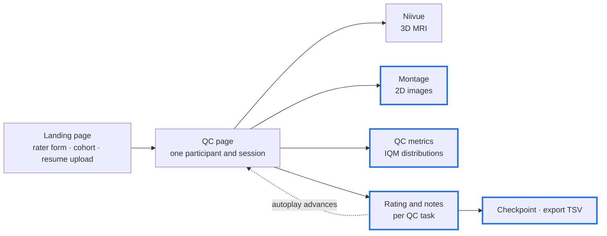
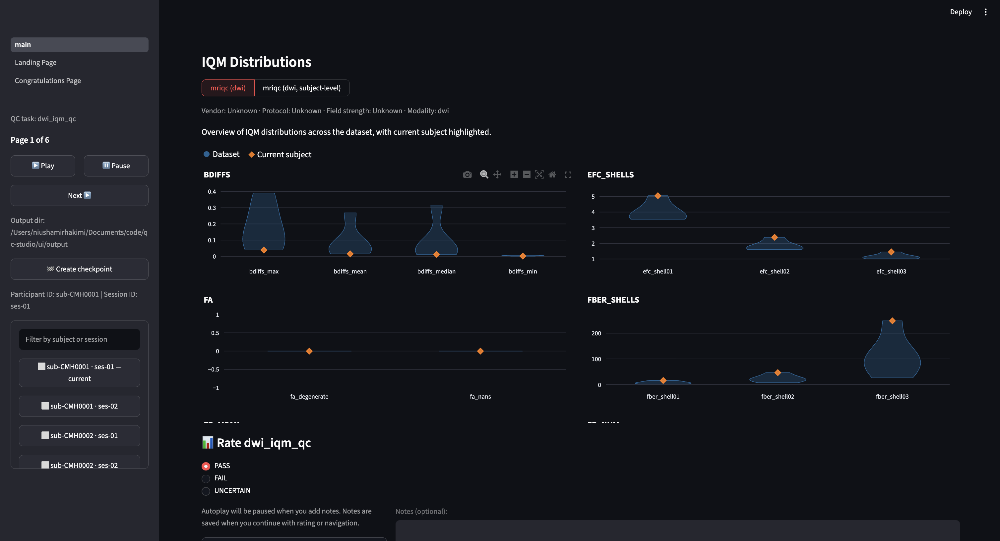
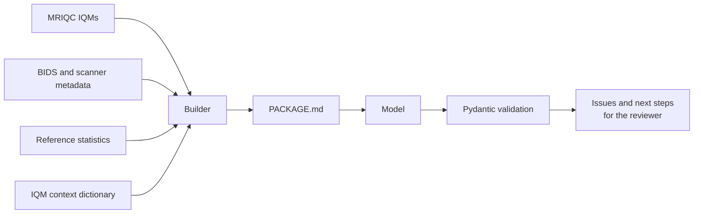

# Google Summer of Code 2026: QC-Studio Contribution Report

**Contributor:** Niusha ([mirhnius](https://github.com/mirhnius))  
**Project:** [QC-Studio](https://github.com/nipoppy/qc-studio)  
**Organization:** [INCF](https://www.incf.org/) (International Neuroinformatics
Coordinating Facility)  
**GSoC project page:** [summerofcode.withgoogle.com](https://summerofcode.withgoogle.com/programs/2026/projects/OkpWFPSn)  
**Status checked:** October 17, 2026

---

### Contents

**Context**

- [Background and Goals](#background-and-goals) — the QC problem, what
  QC-Studio does, and what I proposed to add
- [Summary of Contributions](#summary-of-contributions) — what I delivered,
  with counts
- [How the Project Evolved](#how-the-project-evolved) — why the priorities
  changed partway through

**The work**

- [1. IQM Viewer](#1-iqm-viewer) — quantitative evidence beside the images
- [2. Evidence Bundles for LLM-Assisted QC](#2-evidence-bundles-for-llm-assisted-qc)
  — packaging QC evidence for a model as a reviewer's companion
- [3. Playwright Browser Testing](#3-playwright-browser-testing) — a
  browser-level test suite and its spec-first workflow
- [4. Rating Persistence and Test Coverage](#4-rating-persistence-and-test-coverage)
  — the bug that silently lost ratings, and the tests that followed
- [5. Caching and Continuous Integration](#5-caching-and-continuous-integration)
  — montage caching, and the project's first automated checks
- [6. Code Review](#6-code-review) — findings across 14 PRs by other
  contributors
- [7. Upstream Niivue Contribution](#7-upstream-niivue-contribution) — a
  dependency gap reported and fixed upstream

**Handoff**

- [What I Learned](#what-i-learned) — what the work taught me
- [Next Steps](#next-steps) — open work, with entry points
- [About This Report](#about-this-report) — how the records were checked

Full records of every PR, issue, review, merge, and closure are in the
[appendices](GSoC_REPORT_APPENDIX.md). To run QC-Studio yourself, the
[Quickstart](https://qc-studio--105.org.readthedocs.build/en/105/overview/quickstart.html)
walks through the bundled demo and
[Configuration](https://qc-studio--105.org.readthedocs.build/en/105/guides/configuration.html)
covers pointing it at your own data. Both are preview builds of the
documentation site in [#105](https://github.com/nipoppy/qc-studio/pull/105); the
published site replaces them once it merges, and the
[Markdown sources](https://github.com/nipoppy/qc-studio/tree/main/docs/source)
are in the repository meanwhile.

---

## Background and Goals

Quality control is one of the largest hidden manual efforts in neuroimaging, and
it is usually not standardized. Workflows produce a wide variety of artifacts —
volumes, surfaces, networks, tables, figures, and summary metrics — and these
often need to be reviewed for every participant and every visit. In current
practice that means opening files by hand, in one tool per output type,
inspecting them visually, and noting quality ratings in a spreadsheet. The
effort is invisible in the published record, slow, error-prone, and hard to
scale. It is also the step standing between a processed dataset and an
analysis-ready one, so when it becomes a bottleneck, the whole study waits.

Because each lab improvises its own procedure, two reviewers on the same dataset
can apply different criteria, and months later it can be difficult to reconstruct
what was decided, on what basis, or by whom.

[QC-Studio](https://github.com/nipoppy/qc-studio) addresses this directly. It is
a web-based quality control application, part of the
[Nipoppy](https://github.com/nipoppy) ecosystem, that gives raters one portable
interface — a browser, used locally or over SSH — for reviewing raw BIDS data,
processed pipeline derivatives, and image quality metrics together, and for
exporting their ratings as a tab-separated table. Because no single QC protocol
fits every study, reviews are defined as configurable "QC tasks" in a `qc.json`
file that a lab adapts to its own criteria, rather than a fixed procedure
imposed on it; ready-made configurations ship for fMRIPrep, FreeSurfer, fsqc,
QSIPrep, XCP-D, and NODDIreg. A QC page can show up to three panels: a 3D MRI
viewer built on NiiVue, a 2D image montage, and a QC metrics panel showing IQM
distributions. Because it runs in a browser, the same review works against a
local dataset or against data on a server over SSH, without moving the data or
installing a viewer per output type.

The result is meant to be structure without rigidity: a review that is
consistent between reviewers because they see the same evidence in the same
layout, and a record that can be read back afterwards — which participants were
rated, against which task, by which rater, and with what notes. The project's
own framing is that neuroimagers should be able to *QC anything, anywhere, all
at once*.

A review session moves through the application like this, with the parts my
work touched outlined:

The application's stated goals are to visualize raw and processed neuroimaging
data in an interactive web app, to support 3D MRI (NIfTI), 2D image montages,
and IQM metrics, and to make structured QC ratings possible through a clean,
intuitive interface.

### Where QC-Studio stood at the start

When this project began, QC-Studio was an early concept rather than a working
tool: prototype code, no real users, and nothing dependable enough for a review
session anyone relied on. The pieces existed in outline — a viewer, a way to
record a rating — but not as something a rater could be handed.

By the end of the summer it was being used on a real dataset by people who were
not its developers. It is still in progress, and this report is explicit about
which parts work, which are built but disabled, and which remain open.

### What this project set out to add

Two things follow from that motivation. First, a reviewer needs quantitative
evidence next to the images, because judging a scan by eye alone discards the
measurements a pipeline such as MRIQC has already produced. Second, and less
obvious until the application is used on a real dataset, the review session
itself has to be dependable: a rating or a note that does not survive
navigation, automatic advance, saving, or resuming is worse than no tool at all,
because the reviewer cannot tell that anything was lost.

My proposal set out three deliverables against that motivation:

- A config-driven architecture using Nipoppy's `DatasetLayout` API, dynamic
  subject loading, unified pagination, and `manifest.tsv` integration.
- An IQM panel comparing subject metrics with local and MRIQC reference
  distributions, including rule-based outlier detection.
- An experimental AI panel displaying pre-generated summaries, with an
  evaluation of their factual accuracy and effect on the review workflow.

The aim behind all three was to reduce the burden of manual QC and to produce
ratings that are reliable and documented.

## Summary of Contributions

My work made QC-Studio's review workflow more informative and more
dependable: I built the panel that puts quantitative quality metrics next to the
images, fixed a bug that silently lost reviewers' ratings, set up the project's
automated checks, started a browser-level test framework, and reviewed a large
share of the code other contributors added.

- **Features and fixes merged:** the IQM viewer (#22), the fix for ratings lost
  during autoplay (#76), SVG montage caching (#62), basic CI checks (#39), and
  terminology and documentation fixes (#34, #66).
- **Testing infrastructure:** a Playwright suite covering 13 specifications
  with 19 tests, plus an opt-in CI workflow running them in two browsers
  (#88, open for review).
- **Research:** an evidence-bundle sandbox that packages MRI QC evidence for
  LLMs, with cloud and local model experiments and documented findings.
- **Code review:** 14 PRs by other contributors, including detailed reviews of
  saving, checkpoints, filtering, multifacet ratings, caching, and
  documentation. Contributors acted on these reviews, and several issues I
  reported were fixed and closed.
- **Upstream impact:** a Niivue issue (#314) I filed led to the loading events
  I asked for being implemented in master.
- **Validated by real use:** new users ran QC on the PPMI dataset on October 7–9,
  2026, successfully. Making the application dependable for sessions like that
  one, and reviewing the PRs that changed the paths they depended on, was the
  work the project most needed from me.
- **Not delivered as proposed:** full Nipoppy `DatasetLayout` and manifest
  integration, production outlier detection, and the AI-summary dashboard panel.
  The next section explains why the priorities changed.

| Activity | Count (October 17, 2026) |
| --- | --- |
| PRs authored | 9: 6 merged, 1 open for review, 1 open draft, 1 closed prototype |
| Issues created in QC-Studio | 21: 9 closed, 12 open |
| PRs reviewed or commented on | 14 |
| PRs merged / closed without merge under my account | 7 / 5 |
| Issues closed under my account | 11 |
| Upstream issues | 1 in niivue/niivue-vscode, closed |

Categories overlap: a PR I authored and merged is counted in two rows, and
closures include issues closed automatically by merging a linked PR. Individual
records are in the [appendices](GSoC_REPORT_APPENDIX.md).

## How the Project Evolved

Two developments changed which of the three proposed deliverables mattered most.

**Real users arrived.** New users were preparing to run QC on the PPMI dataset,
which turned reliability from a quality concern into a blocking one — an AI
panel on top of an application that could drop a rating would not have been
worth building. Rating persistence, saving, filtering, checkpoints, and notes
all needed attention, and other contributors were changing those same paths at
the same time, so reviewing their PRs became a priority in its own right. Those
sessions ran on October 7–9, 2026 and went successfully, which is the clearest
measure I have that the shift was right. The margin was narrow: I retested the
multifacet ratings work on October 6 and it merged on the 8th, mid-window.

**The compute for open-weight models was not there.** The AI deliverable assumed
local experimentation with open-weight models. The models I could run on my
laptop were too small for the task and the larger ones would not run at all, so
the work stopped at a sandbox — a finding about what this line of research
needs, rather than a result I could extend by trying harder. Section 2 describes
what it allowed and what it ruled out.

| Original goal | What I did | Where it stands |
| --- | --- | --- |
| Nipoppy-integrated architecture | **I did not build this.** That effort went into reliability instead, because that is what the project needed: reviewing 14 PRs on the save, resume, filtering, and navigation paths, and filing 21 issues on what I found. | `DatasetLayout` and `manifest.tsv` integration remain open. Pagination was implemented by other contributors and is credited to them. |
| IQM distributions and outlier detection | Merged IQM viewer: dataset distributions, scan-level tables, multiple metric sources, DWI support, tests, and reference-data infrastructure. | The panel is live. Reference comparison is built but disabled pending #82; production outlier detection remains future work. |
| AI summaries and evaluation | Structured evidence packages, model experiment scripts, response-schema validation, and findings on cloud and local models. | A working sandbox with documented findings. Dashboard integration and a larger evaluation need compute first. |

Work added beyond the proposal: the autoplay persistence fix, CI and local
checks, montage caching, the Playwright suite, the reviews, and the
upstream Niivue report.

## 1. IQM Viewer

**Merged:** [PR #22](https://github.com/nipoppy/qc-studio/pull/22), September 10,
2026. Closes [#12](https://github.com/nipoppy/qc-studio/issues/12) and
[#23](https://github.com/nipoppy/qc-studio/issues/23).

Reviewers could see the images but not the numbers. Pipelines such as MRIQC
already measure signal-to-noise, motion, and sharpness for every scan, but those
values sat in the derivatives while the rating was made on visual impression
alone. The IQM viewer brings them onto the same screen as the scan being rated,
so a decision can rest on the measurement as well as the picture.

**What it does.** Each QC task declares its own metric sources in `qc.json`, so
the panel is not tied to MRIQC: any pipeline that writes metrics as JSON can be
displayed, with its own metric set, version-suffixed pipeline names, and
modality. Each source appears in its own tab. Sources with many rows are drawn
as distributions across the dataset, with a marker scoped to the run under
review so a reviewer can see where their scan falls; a single-row source is
shown as a metrics table instead. MRIQC-like sources use curated metric groups,
and anything else falls back to per-column display, so an unfamiliar pipeline is
degraded rather than unsupported.

*Reviewing `sub-CMH0001`, `ses-01`. The two tabs are the task's two configured
metric sources; the orange diamond marks where this scan falls in each dataset
distribution, with the rating controls on the same screen.*

**How it got there.** The first version was MRIQC-only, with modality groupings
hardcoded in a top-level setting. Moving to a per-task `iqm_path` list, mirroring
the existing `svg_montage_path` pattern, made metrics a property of a QC task
rather than an MRIQC add-on — and that is what made the panel general. Diffusion
support then needed only an extension to the metric registry, no new display
code.

**Reference comparison is built but disabled.** Comparison against an MRIQC
reference population sits behind a hidden control: the population distribution
turned out markedly different from the dataset under review, which would mislead
a reviewer more than inform them.
[#82](https://github.com/nipoppy/qc-studio/issues/82) tracks what it needs
before it returns.

This section is a summary. The design evolution, the reference-data
investigation, the implementation, and the tests are written up in full in
**[IQM Viewer Branch](IQM_VIEWER_BRANCH_EXPLANATION.md)**, which is where to
start if you are picking this work up.

## 2. Evidence Bundles for LLM-Assisted QC

**Experimental:** [`evidence_bundle` branch](https://github.com/nipoppy/qc-studio/tree/evidence_bundle),
issues [#24](https://github.com/nipoppy/qc-studio/issues/24),
[#33](https://github.com/nipoppy/qc-studio/issues/33),
[#40](https://github.com/nipoppy/qc-studio/issues/40).

**The purpose was a companion, not an automated rater.** Deciding whether a scan
passes is a hard problem, and the right tool would be a model trained for it — a
classifier or deep-learning model — not a general language model. Even
purpose-trained models are not reliably successful at it, so asking an LLM for
the final verdict is the wrong use of it. What an LLM can usefully do is point
out the possible issues and say what to follow up on: what to look at next, and
what the reviewer should judge for themselves. The decision stays with the
human, and that framing shaped the whole design.

**The package.** For one subject and session, the builder assembles a Markdown
file holding the IQMs that matter — statistical outliers plus those important
for that modality — the statistics around each, and the instructions telling the
model how to behave. The per-metric context comes from a dictionary I built by
extracting the MRIQC documentation with Codex: what each metric means, which
direction is concerning, when it is informative. A metric therefore reaches the
model already interpreted rather than as a bare number.

**The intended product.** On starting a session, a batch of subjects would be
sent to the model, and each subject's summary of possible problems and suggested
next steps would be shown as a pop-up when the reviewer reaches them.
Summarization first, with a chat interface for follow-up questions later.

**Where it stopped.** The text stage worked: the Claude API read the package and
returned a structured response, validated with Pydantic. Images were the next
step, and that needed the local vision model the project intended to use. I
could not run it on my own machine, and the server for it was not yet available,
so the work stopped there rather than at a design dead end.

**What the experiments showed.** The small local models returned schema-valid
JSON that still confused metric values with percentiles and flagged metrics
contradicting their own prose. Format validity and correct reasoning are
separate problems, and only the first is cheap to check automatically — which is
the strongest argument for keeping this a companion that surfaces things to
check rather than anything that produces a rating.

This section is a summary. The purpose, how a package is assembled, the sandbox
layout, the cloud and local model experiments, and the infrastructure limits
that stopped the work are written up in full in
**[Evidence Bundle Branch](EVIDENCE_BUNDLE_BRANCH_EXPLANATION.md)**, which is
where to start if you are picking this work up.

## 3. Playwright Browser Testing

**Open for review:** [PR #88](https://github.com/nipoppy/qc-studio/pull/88),
from [#75](https://github.com/nipoppy/qc-studio/issues/75).

**Why a browser layer at all.** Three bugs I had worked on (#73, #81, #84)
shared a shape: the logic was correct in isolation, and the failure lived in the
wiring between real widgets, session state, and Streamlit's rerun cycle.
`ui/tests/` mocks Streamlit out, so by construction it cannot see that class of
bug — no amount of additional unit testing would have caught them. I made that
argument in #75 before writing any code.

**Why this structure.** Playwright was new to me, so rather than invent a layout
I studied how Streamlit's own `e2e_playwright` suite is organised — specifically
how it survives Streamlit changing its internals, which is by wrapping the
fragile parts so there is one place to fix rather than many. I copied that
principle into four layers: a fixture that launches the real app, a fixture that
hands over a loaded page, a shared layer owning every selector and every rerun
wait, and the tests, which know about none of it. A test therefore describes a
rater's journey and nothing about Streamlit's DOM.

That decision was vindicated sooner than expected. `requirements.txt` asks only
for `streamlit>=1.56`, and a local 1.58 against a CI 1.65 rendered radio widgets
differently, failing sixteen tests that had passed locally. Because every
selector lived in one module, the fix — locating widgets through their ARIA role
and accessible name instead of the component library's internals — touched one
file and no test bodies.

**Why specifications come first.** Each test begins as a Markdown spec
describing the scenario and what should be observable afterwards. Writing it
first makes the expected behaviour reviewable while disagreements are still
cheap to settle, rather than after a test has been written against the wrong
idea. The suite now covers 13 specifications with 19 tests across 10 files,
spanning the paths a lost rating would travel: form validation, navigation,
upload and resume, checkpoints, the export overwrite guard, notes, autoplay, and
multi-task rating.

**Why the agent skills are committed.** The spec-first loop only works if
everyone follows it, and contributors increasingly write tests with an AI
assistant. Left to itself, each assistant invents its own conventions — its own
selector habits, its own idea of what an assertion should check — and the suite
drifts apart from the inside. So the conventions are committed to the branch as
skills, covering this suite's architecture, Playwright usage, code review, and
test generation. Anyone working on the repository with an assistant gets the
same behaviour, which is the only way shared conventions hold across
contributors who never meet. Personal settings are deliberately left
uncommitted, since a permission allowlist belongs to a machine, not a project.

**Why CI runs on request, not on every push.** Starting a real server and
driving two browsers costs minutes rather than seconds, and most changes cannot
break these tests, so gating every commit on them would buy little and slow
everyone down. Instead the workflow is triggered deliberately: by pressing Run
workflow, or by adding a `run-e2e` label to a pull request, which is the useful
case — a PR touching the UI gets the run reported on itself, where a reviewer
will see it. Failures upload screenshots and video, since the point of CI here
is seeing what broke on a machine you cannot open a browser on.

**The suite earned its keep immediately.** Writing the tests surfaced behaviour
no mocked test could have reached — the clearest being that the Next tooltip
tells a rater to set a rating for every task before continuing while nothing
enforces it, so the untouched tasks never reach the export. These are product
questions rather than test failures, so they are written up on the branch for
whoever owns the behaviour to decide, and the two sharpest are pinned by
`xfail(strict=True)` tests: CI stays green, and the test fails loudly the moment
the behaviour changes.

This section is a summary. The four layers, the synchronization problem, the
selector strategy, the specification template, and the shared conventions are
documented in full in
**[Playwright E2E Branch](PLAYWRIGHT_E2E_BRANCH_EXPLANATION.md)**, which is
where to start if you are picking this work up.

## 4. Rating Persistence and Test Coverage

**Merged:** [PR #76](https://github.com/nipoppy/qc-studio/pull/76), September 2,
2026, fixing [#73](https://github.com/nipoppy/qc-studio/issues/73).

A reviewer reported that ratings selected during autoplay were sometimes missing
from the saved output. The report was intermittent, so I framed it as a timing
problem and opened #73 around the hypothesis that clicks near the
automatic-advance boundary were the ones being lost.

The code confirmed it. A rating click never saved itself; it only reached the
record when the autoplay timer next polled `session_state`. Each advance rotated
the widget key, so a click landing after one was read from a key that no longer
belonged to the subject being rated, and the rating disappeared with no error.
The fix was to stop the timer owning persistence: the rating now saves through
the widget's `on_change` callback, guarded so an empty read cannot overwrite an
existing value.

**The underlying problem is Streamlit.** It is not equipped for this level of
accuracy. Rerunning the whole script on every interaction, with state in widget
keys, leaves no reliable moment to capture a value arriving while the page
changes underneath it — and autoplay makes that worse, because the page changes
on a timer rather than in response to the reviewer. This fix narrows the window
without removing the class of problem, which is why I later argued for
browser-level tests.

**Looking closely surfaced more.** Working through this part of the codebase
turned up further problems, which I reported rather than worked around: notes
discarded on forced navigation
([#84](https://github.com/nipoppy/qc-studio/issues/84)), partial progress lost
with no way to save it ([#81](https://github.com/nipoppy/qc-studio/issues/81)),
notes not persisting to the saved TSV
([#11](https://github.com/nipoppy/qc-studio/issues/11)), autoplay continuing
after a return to the landing page
([#78](https://github.com/nipoppy/qc-studio/issues/78)), the IQM panel being
unreliable during automatic advance
([#77](https://github.com/nipoppy/qc-studio/issues/77)), and autoplay counting
image loading as review time
([#72](https://github.com/nipoppy/qc-studio/issues/72)). The first three are now
closed, fixed by other contributors.

**There were no tests for the QC viewer.** `ui/tests/test_qc_viewer.py` was 26
lines covering a single filename helper — nothing exercised rating persistence,
automatic advance, record saving, pagination, or the countdown. I added roughly
800 lines covering those paths, including a test that fails under the original
bug. Writing them meant working through the implementation rather than reading
it, and that is where most of my understanding of this codebase came from.

## 5. Caching and Continuous Integration

**Montage caching** ([PR #62](https://github.com/nipoppy/qc-studio/pull/62),
closes [#43](https://github.com/nipoppy/qc-studio/issues/43)). Montages were
re-read and re-rendered on every widget interaction. Caching is the obvious move;
the real work is the cache key, which required normalizing the path list to a
tuple so Streamlit could use it. I kept `load_svg_data()` as the public entry
point and moved the expensive loading, conversion, and assembly into a cached
helper, so callers did not change. I deliberately left `st.fragment` out of the
same pass and said why in the PR: fragmenting the rating and notes panel risked
widget state going stale when the participant changed, which is the bug class I
had just fixed in #76.

**CI and local checks** ([PR #39](https://github.com/nipoppy/qc-studio/pull/39),
from my proposal in [#35](https://github.com/nipoppy/qc-studio/issues/35)). The
project had no automated checks, so the question was how much to introduce at
once. I staged it: Black, Flake8, and codespell first, with the test workflow
left as an explicit follow-up, because which tests gate every PR is a maintainer
decision rather than something to settle inside a configuration PR. Adding a
formatter to an existing codebase also produces a large diff, which should not
ride along with a behavioral change.

Pre-commit runs the same tools against the same configuration files as CI, so
hooks and CI cannot disagree, and the file filters are scoped to `ui/` and
`pipelines/` Python plus named config files so whitespace hooks do not rewrite
sample data. A local pytest hook runs the UI tests before a commit instead of
after a push.

Two smaller maintenance PRs came out of working in the code:
[#34](https://github.com/nipoppy/qc-studio/pull/34) replaced SVG-specific
wording with montage terminology once the panel handled 2D images generally, and
[#66](https://github.com/nipoppy/qc-studio/pull/66) repaired broken
documentation links.

## 6. Code Review

I reviewed 14 PRs by other contributors, combining code reading with manual
checks of real review sessions and focusing on whether ratings and notes survive
navigation, filtering, saving, and resuming. Where possible I retested fixes
before approving. The implementations are their authors'; these are my findings.

Most of what I caught were quiet failures — cases where the application would
have carried on without an error, which is exactly what a reviewer working
through a cohort would not notice.

**For the details** — every review, what I found in it, and links to the
comments — see
[Appendix C](GSoC_REPORT_APPENDIX.md#appendix-c-review-and-comment-activity-on-others-prs).

## 7. Upstream Niivue Contribution

**Reported and closed:** [niivue/niivue-vscode #314](https://github.com/niivue/niivue-vscode/issues/314).

QC-Studio needs to know when a volume is visible before starting a review timer.
I traced a missing signal to the Streamlit Niivue component and requested
separate `base_loaded` and `fully_loaded` events back to Python, explaining the
effect on autoplay and on slow readiness checks in browser tests. A maintainer
confirmed on September 29 that support was implemented in master and planned for
the next beta
([response](https://github.com/niivue/niivue-vscode/issues/314#issuecomment-5885125915)).
The maintainer implemented the change; adopting it in QC-Studio is a separate
step.

## What I Learned

- **Where code lives decides whether it can be reused.** Moving the IQM
  configuration from a global MRIQC setting to a per-task `iqm_path`, and
  lifting reference handling out of the loader module, were both prompted by
  review, and both made later work cheaper — DWI support needed no new display
  code.
- **Deciding what not to ship is part of the work.** Hiding the reference
  comparison pending #82, declining `st.fragment` in #62, and staging CI across
  two PRs were judgment calls, and I recorded the reasoning each time so it
  could be argued with.
- **Reproducibility is what makes a finding useful to someone else.** Turning
  intermittent reports into reproducible issues, regression tests that fail
  under the original conditions, and readable specifications is what let other
  contributors act on what I found.
- **Review is a design conversation.** The strongest parts of #22 came out of
  review comments, and my own reviews aimed at the same thing: name the concrete
  failure case, then retest it.
- **Open-source maintenance is its own skill** — follow-up, verification,
  merging, and closing superseded work. I also helped clarify expected save and
  navigation behavior in
  [issue #89](https://github.com/nipoppy/qc-studio/issues/89#issuecomment-5674629745).

## Next Steps

| Work | Next step |
| --- | --- |
| Playwright suite, #88 / #75 | Open for review. Decide the scope of the committed agent skills, and act on the product questions in `e2e/FINDINGS.md`. |
| IQM reference distributions, #82 | Clean and validate reference data before restoring the comparison control. |
| IQM/autoplay interaction, #77 | Investigate rendering and automatic advance with realistic matching inputs. |
| Montage task/run metadata, #61 (draft) | Finish it or document what remains. |
| Documentation website, #105 | Follow up on startup instructions, docs CI, sample-data hook scope, filename consistency. |
| Export semantics, #112 | Clarify merge versus replace and align the warning. |
| Niivue loading events | Verify release availability and use the events for timing and tests. |
| Evidence-bundle experiments, #24 / #40 | Expert-review metric context, improve reference data, define a larger evaluation. |

Beyond these, the proposal's full Nipoppy layout and manifest integration,
production outlier detection, AI-summary dashboard panel, and workflow-impact
evaluation are natural follow-ons to the IQM viewer and evidence-bundle work.

## About This Report

Counts and status are as of October 17, 2026, checked against the repository's
PR, issue, review, merge, and closure history. The original proposal summary,
the PPMI onboarding and its outcome, and the hardware limits on open-weight
model experiments come from my own records rather than that history. Where a fix
was implemented by another contributor, it is credited to them throughout.

## Acknowledgements

Thank you to my GSoC mentors, especially Nikhil Bhagwat, for their guidance
throughout this project and [INCF](https://www.incf.org/) for hosting this project in Google
Summer of Code 2026.

## More Detail

[Appendices](GSoC_REPORT_APPENDIX.md) (all PRs, issues, reviews, merges, and
closures) ·
[IQM viewer](IQM_VIEWER_BRANCH_EXPLANATION.md) ·
[Playwright](PLAYWRIGHT_E2E_BRANCH_EXPLANATION.md) ·
[Evidence bundles](EVIDENCE_BUNDLE_BRANCH_EXPLANATION.md)
